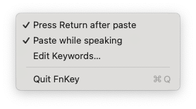
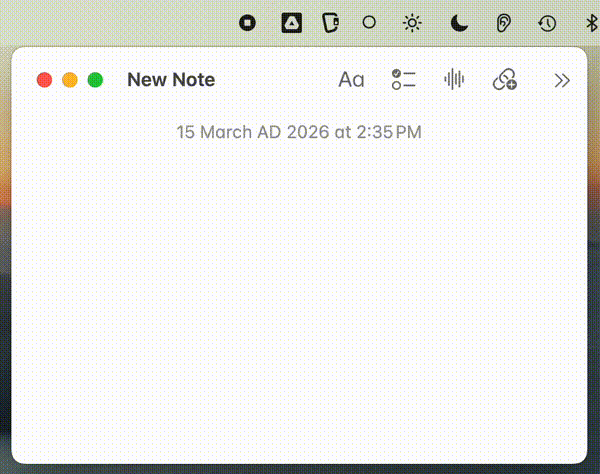

# FnKey.app

[](https://github.com/evoleinik/fnkey/releases/latest)
[](https://github.com/evoleinik/fnkey/releases)
[](https://github.com/evoleinik/fnkey/actions/workflows/test.yml)
[](LICENSE)


A tiny Rust menu bar app for macOS. Hold Fn, speak, release, and the text is pasted where your cursor is.
The microphone is on only while you hold the key, and macOS shows its orange mic dot to confirm it.

<p align="center"></p>

<p align="center"></p>

If you find FnKey useful, please [star the repo](https://github.com/evoleinik/fnkey). It helps others find it.

## Install

1. Download the latest [release](https://github.com/evoleinik/fnkey/releases/latest):
   - **Apple Silicon** (M1 and later): `FnKey-arm64.zip`
   - **Intel**: `FnKey-x64.zip`

2. Unzip it and move the app to Applications:
   ```bash
   unzip FnKey-arm64.zip
   mv FnKey.app /Applications/
   ```

3. Add your API key or keys:
   ```bash
   mkdir -p ~/.config/fnkey

   # Deepgram: streaming, recommended. New accounts get $200 of free credit.
   echo 'your-deepgram-key' > ~/.config/fnkey/deepgram_key

   # Groq: used when Deepgram cannot answer, or on its own if you have no Deepgram key
   echo 'your-groq-key' > ~/.config/fnkey/api_key

   # Optional: the Deepgram region closest to you (see "Deepgram region" below)
   echo 'api.eu.deepgram.com' > ~/.config/fnkey/deepgram_host
   ```
   Get keys at [console.deepgram.com](https://console.deepgram.com) and [console.groq.com](https://console.groq.com).

4. Launch it:
   ```bash
   open /Applications/FnKey.app
   ```

5. Grant permissions in **System Settings → Privacy & Security**:

   | Permission | Why | How |
   |------------|-----|-----|
   | **Input Monitoring** | To see the Fn key | Add FnKey.app with the + button |
   | **Microphone** | To hear you | Asked on first use, or add it by hand |
   | **Accessibility** | To paste the text | Add FnKey.app with the + button |

**Upgrading:** release builds are signed without a developer certificate, so macOS treats each new
version as a new app. After you replace FnKey.app, check the three permissions again and reopen FnKey.

## Usage

Hold **Fn** and speak. Release, and the text is pasted. The menu bar icon shows ○ when idle and ● while recording.

| Menu item | What it does |
|-----------|--------------|
| **Press Return after paste** | Presses Return after the text, to send a chat message in one go |
| **Paste while speaking** | Pastes each finished phrase while you still hold Fn, instead of all at once on release |
| **Edit Keywords…** | Opens your custom vocabulary in a text editor |
| **Quit FnKey** | Quits the app |

## Settings

Everything lives in `~/.config/fnkey/`. Each setting is one small text file.

| File | Contents | Default |
|------|----------|---------|
| `deepgram_key` | Deepgram API key | none |
| `api_key` | Groq API key | none |
| `deepgram_host` | Deepgram server, such as `api.eu.deepgram.com` | `api.deepgram.com` (US) |
| `keywords` | Custom vocabulary, one term per line | none |
| `auto_return` | `1` turns on **Press Return after paste** | off |
| `live_paste` | `1` turns on **Paste while speaking** | off |
| `error.log` | Problems FnKey ran into, written by the app | |

The two menu toggles write their own files. Other files are read when FnKey starts, so reopen it after editing them.

## How it works

| Backend | Mode | Key file | How it works |
|---------|------|----------|--------------|
| **Deepgram Nova-3** | Streaming | `deepgram_key` | Audio streams over a WebSocket while you speak. Fastest. |
| **Groq Whisper** | Batch | `api_key` | The whole clip is sent after release. Used when Deepgram cannot answer. |

- **Taps and shortcuts are ignored.** A press shorter than 0.3s, or Fn used with another key (Fn+Delete,
  Fn+arrows), records nothing and pastes nothing.
- **No invented text.** When Deepgram hears no speech, nothing is pasted. Groq runs only when Deepgram
  errors or does not answer within 10s, because Whisper turns silence into phrases like "Thank you for watching!"
- **Paste while speaking.** Deepgram finishes a phrase after a short pause, or every 3 to 5 seconds of
  continuous speech. Each finished phrase is pasted right away, so a short dictation still pastes on release.
  Return, if on, is pressed once at the end, and text is never pasted twice.
- **Your clipboard comes back.** Whatever you had copied (text, images, files, rich text) is restored 0.5s
  after FnKey pastes. It is left alone if you copy something new in the meantime, and a password marked as
  concealed is never put back.
- **Clipboard history stays clean.** Clipboard managers such as Alfred get one entry per dictation. Single
  phrases and the restored item are marked transient ([nspasteboard.org](https://nspasteboard.org)), so they
  are not recorded.

### Deepgram region

Deepgram's default server is in the US. Far from it, every press waits longer, and slow replies can miss the
10s wait. Point FnKey at the closest region. Your key works on all of them.

```bash
echo 'api.in.deepgram.com' > ~/.config/fnkey/deepgram_host   # or api.eu / api.au
```

Measured from Bangkok, four runs each: release to text took 0.16–0.18s on `api.in`, against 0.35–6.5s on the US default.

## Custom keywords

Add words the transcription often gets wrong, such as names and technical terms:

```bash
# Edit from the menu bar (Edit Keywords…), or directly:
cat > ~/.config/fnkey/keywords << 'EOF'
# One term per line
Anthropic
Claude
cron job
Kubernetes
EOF
```

Keywords go to Deepgram as `keyterm` and to Groq as a `prompt` hint. They are read when FnKey starts.

## Troubleshooting

FnKey writes problems to `~/.config/fnkey/error.log`. Each Deepgram line names the server, the connect
time and how much audio was sent.

| Log line | What it means |
|----------|---------------|
| `Deepgram heard no speech` | The audio was silent. Check the input device in System Settings → Sound. |
| `Deepgram: no result after waiting 10s` | The network was too slow. Try a closer `deepgram_host`. |
| `Deepgram text arrived after the 10s wait` | Deepgram answered, but too late. A closer region fixes this too. |
| `Clipboard restore failed` | FnKey could not put your clipboard back. The counts show what it tried to restore. |

## Build from source

```bash
./build-app.sh   # builds, installs to /Applications/FnKey.app and signs it
cargo test       # unit tests; the clipboard tests use a private pasteboard
```

`build-app.sh` signs with a fixed local identity ("FnKey Dev"), so permissions survive rebuilds. If cargo
isn't found, run `/bin/bash -l -c './build-app.sh'`. Signing needs the login keychain, so over SSH it fails
with `errSecInternalComponent`. Run the script in Terminal on the Mac itself.

## Roadmap

- Follow the current microphone when the default input changes, for example AirPods connecting
- A language setting: English only, or automatic detection
- Skip silent clips in Groq-only mode, using Whisper's `no_speech_prob`
- A menu option to switch between Deepgram and Groq

## Notes and known limitations

- If no Fn key is detected within 5s of launch, FnKey uses the Option key instead.
- **A short start-up delay.** The microphone switches on when you press Fn, so the first instant of
  speech can be missed. Removing that would mean keeping the microphone on all the time, with the mic dot
  always showing. FnKey chooses privacy.

## License

[GPL-3.0](LICENSE)
